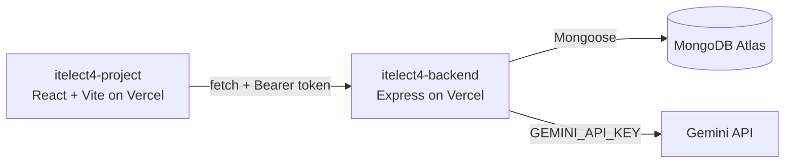

# Campus Event & Activity Tracker

- **Live site:** itelect4-project-rho.vercel.app
- **Backend repo:** https://github.com/EndayaRK/itelect4-backend

## Project Concept

A React + TypeScript web application for managing campus events, user registrations, and event sign-ups. This project is built using Vite and demonstrates typed React components with TypeScript.

## Tech Stack

- React 18
- TypeScript
- Vite

## Architecture

## Installation & Setup
Install dependencies

npm install

Start development server

npm run dev
